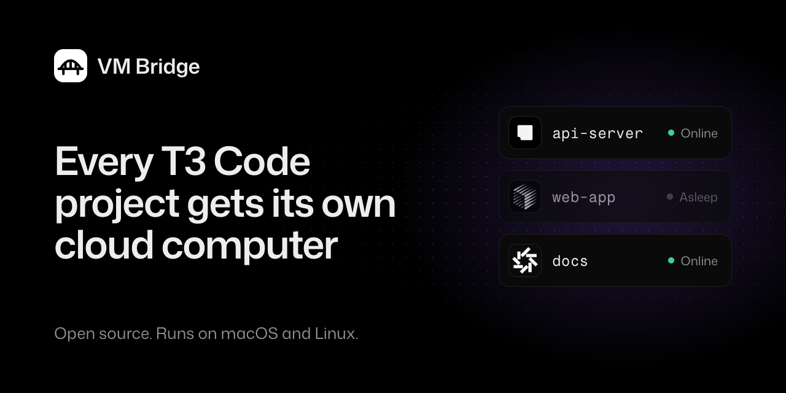

# VM Bridge



VM Bridge is a free, open source server that runs [T3 Code](https://github.com/pingdotgg/t3code)
agents on cloud VMs. Pair T3 Code with it once, and it gives each project its own VM (and more when
the project gets busy), puts idle VMs to sleep and wakes them when you send a message. It runs on macOS and Linux, and you pay only your
cloud provider for the VMs.

Website and docs: [vmbridge.ordinity.com](https://vmbridge.ordinity.com)

- Use several providers at once: boxd, Instabox, Daytona, Boat, Railway, E2B, Freestyle and
  Superserve. New VMs go to your default provider, or to the one you pick for a repository.
- A VM sleeps when it sits idle and wakes when you send a message.
- Small VMs by default. When a project runs more threads than its VM can take, new threads go to
  another VM for that project.
- One dashboard, behind a password, for providers, GitHub, agent sign-ins, pairing devices and a
  live view of your VMs.
- Environment variables you set once reach every VM, for agents and shells.
- Agent skills from [skills.sh](https://skills.sh) or from this machine reach every VM, for Claude
  Code and Codex.
- Your global `AGENTS.md` (and Claude Code's `CLAUDE.md`) on this machine can follow you to every VM.
- Works over your local network, Tailscale and Cloudflare Tunnel.

## Install

macOS and Linux:

```sh
curl -fsSL https://raw.githubusercontent.com/vkpdeveloper/vmbridge/main/install.sh | sh
```

This installs one `vmbridge` file in `~/.local/bin` (set `VMBRIDGE_INSTALL_DIR` to change it).
Run the same command again to update.

## Get started

1. Run `vmbridge` and open one of the setup links it prints.
2. Choose a dashboard password, add a provider, sign in your agents and choose whether to bring your
   skills and instructions. GitHub is under **Setup** in the dashboard.
3. Under **Devices**, create a pairing link and paste it into T3 Code as a remote environment.

Start a thread in T3 Code and VM Bridge brings up a VM for it.

## Busy projects

New VMs get about 2 vCPU and 8 GB (the closest size each provider has) unless you pick a size in
**Settings** or for a repository. A project starts on one VM. When you start a new thread, VM Bridge
picks one of the project's VMs that has room: fewer than 2 running turns per vCPU, under 80% of its
memory used and at least 3 GB of disk free. In our tests, 2 turns per vCPU took 1.5x to 2x as long as
one turn alone, 3 per vCPU took 2x, and 4 per vCPU took over 3x, with tests starting to fail.

- An awake VM with room comes first (the least loaded), then a sleeping one, which is woken.
- With no room anywhere, VM Bridge adds a VM like the project's first one, up to 4 per project.
- If the provider refuses a new VM (quota, billing), the thread goes to the least loaded VM, and
  its setup shows why it may be slow. VM Bridge tries adding a VM again after 10 minutes.
- Threads never move. A thread's worktree, branch and unpushed changes stay on the VM it started on.
  Subagents an agent starts run on its VM too.
- Extra VMs sleep when idle like any other, and are never deleted on their own, since they may hold
  unpushed work. Delete one from the dashboard when you no longer need it.
- The project's branch list shows branches from all its VMs, without pushing. A new thread started
  from a branch only some VMs have goes to one of those, even a busy one, since a new VM would not have
  it. If those VMs are gone, the usual rules apply.

## Environment variables

Under **Settings**, **Environment**, add variables such as `NPM_TOKEN` or `API_URL`. Every VM gets
them: T3, the agents and the commands they run, and login or interactive shells such as SSH. Awake
VMs restart T3 to apply a change once nothing runs on them, so a running turn is never cut off.
Sleeping VMs apply it when they wake, before serving anything. Values are stored with your other
secrets and never shown again. Names VM Bridge sets itself, such as `PATH`, `HOME`,
`CLAUDE_CONFIG_DIR` or `GH_TOKEN`, are refused.

## Skills

Under **Skills**, press **Add skill** to install one from skills.sh, or use the **This machine** tab
to pick ones found in `~/.claude/skills`, `~/.agents/skills` or `~/.codex/skills`. Every VM gets
them for Claude Code and Codex: awake VMs right away, without restarting anything, and sleeping VMs
before they serve anything when they wake. Edits to a local skill reach the VMs within a few
seconds. Removing a skill takes it off every VM, and skills put on a VM some other way are left
alone.

Switch on **Sync all** to install every skill on this machine without picking them one by one. New
skills in those folders follow within a few seconds, and a skill deleted here comes off the VMs. When
two folders hold a skill with the same name, the first in the order above wins. Skills over 5 MB are
skipped. Turning it off keeps what it installed until you remove it.

The AGENTS.md tab on the same page lists each agent's global file found on this machine,
`~/.claude/CLAUDE.md` for Claude Code, `~/.codex/AGENTS.md` for Codex and
`~/.config/opencode/AGENTS.md` for OpenCode (`$CLAUDE_CONFIG_DIR`, `$CODEX_HOME` and
`$XDG_CONFIG_HOME` move them). Switch one on and every VM gets it where that agent reads it, the
same way as skills, and edits follow within a few seconds.
Switching it off, or deleting it here, takes it off the VMs. VM Bridge only replaces or removes a
file it wrote: if a VM already has its own, or the file was edited on the VM, it is left alone.

## Encryption

VM Bridge encrypts everything sensitive it saves, by default, with AES-256-GCM: provider keys, the
GitHub token, environment variables for VMs, each VM's T3 token, installed skill files and agent
sign-ins. Chat history, queued messages, logs and settings are not encrypted. They stay in files
only your user can read.

On first start VM Bridge makes a random key in `~/.vmbridge/encryption.key`, readable only by your
user. Set `VMBRIDGE_ENCRYPTION_KEY` to 32 random bytes in base64 (`openssl rand -base64 32`) to use
your own key instead. The key file sits next to your data, so keeping the key outside the folder, in
that variable, is stronger.

Back up the key somewhere apart from your data, such as a password manager. VM Bridge will not start
with the wrong key or without its key, so it never overwrites what you saved. If the key is lost, no
one can read those values again: start with a new data folder and add your provider keys, agent
sign-ins, environment variables and GitHub token again.

Updating from a version without encryption encrypts your saved data on first start. After that,
older versions can't read it, so don't go back to one.

## Cloudflare Tunnel

Cloudflare Tunnel gives VM Bridge an HTTPS address on the public internet, without opening a port.
Install Cloudflare's free `cloudflared` tool (`brew install cloudflared`) and a switch shows up under
**Settings**, **Addresses**. It is off until you turn it on, because anyone on the internet can then
reach your login page. Your dashboard password, pairing links and the one-time setup link still
protect everything behind it. Its address then shows with the others: in Settings, in the links
`vmbridge run` prints and in pairing links.

- **Free address:** leave the domain empty. You get a random trycloudflare.com address, no account
  needed, and it changes every time VM Bridge restarts.
- **Your own domain:** run `cloudflared tunnel login` once, then type a hostname such as
  `bridge.example.com` on a domain in your Cloudflare account. VM Bridge makes a tunnel named
  `vmbridge-` plus the first 8 characters of its ID and adds the DNS record. It never replaces a
  record you already have.
- **Dashboard tunnel:** make a tunnel in the Cloudflare dashboard, paste its token and type the
  hostname you gave it there. The token is kept with your other secrets.

cloudflared connects to VM Bridge on a port of its own on this machine, picked the first time you
turn the tunnel on and kept after that. Settings shows it: point a dashboard tunnel's hostname at
`http://localhost:` plus that port. If another app takes the port, VM Bridge picks a new one, and you
update the dashboard tunnel to match. The tunnel's config and credentials live in
`~/.vmbridge/cloudflared`.

- Free addresses cannot stream live updates, so the dashboard refreshes every 5 seconds there.
- VM Bridge only believes the visitor address and HTTPS details Cloudflare adds when they arrive on
  the tunnel's port from this machine, so failed logins are counted per visitor.
- While it is on, the tunnel starts and stops with VM Bridge, including when you close its terminal.
  If cloudflared stops on its own, VM Bridge starts it again after a second, waiting longer after
  each failure, up to a minute. Its warnings and errors go to the VM Bridge log with tokens hidden.

## Commands

```
vmbridge [run] [--host 0.0.0.0] [--port 3774]   Start in this terminal
vmbridge stop                                   Stop, including the background service
vmbridge service install [--host] [--port]      Run in the background at login
vmbridge service uninstall                      Remove the background service
vmbridge password                               Set a new dashboard password
```

Your data lives in `~/.vmbridge`. Set `VMBRIDGE_HOME` to keep it somewhere else. On a machine with
no terminal, set `VMBRIDGE_PASSWORD` for the first start, or run `vmbridge password`.

Sizes, sleep behaviour and notes for each provider: [docs/PROVIDERS.md](docs/PROVIDERS.md).

## License

[MIT](LICENSE)
